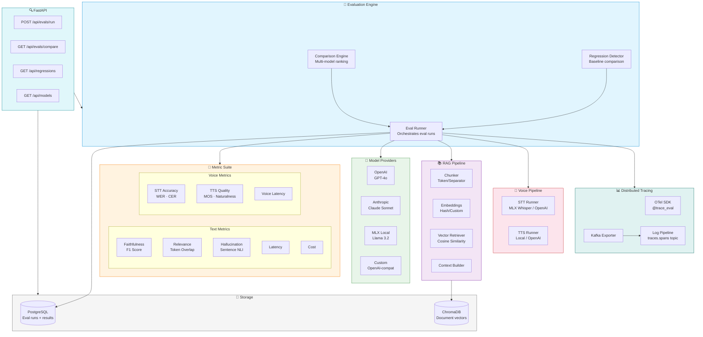
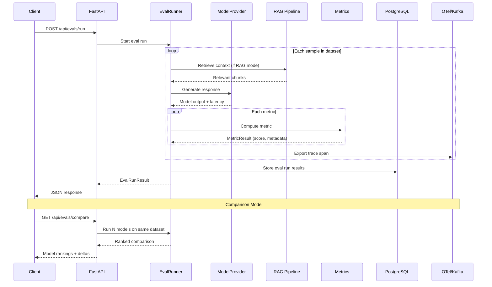
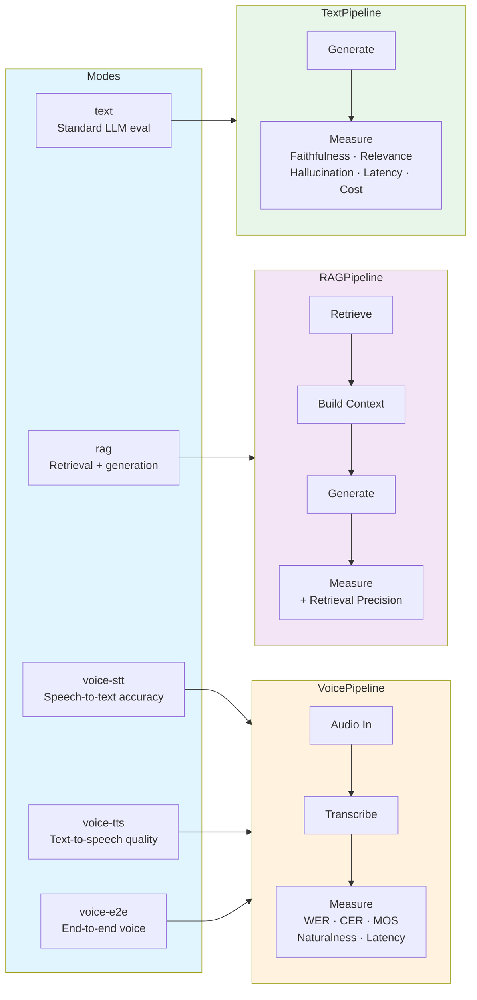
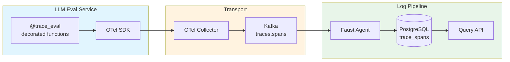
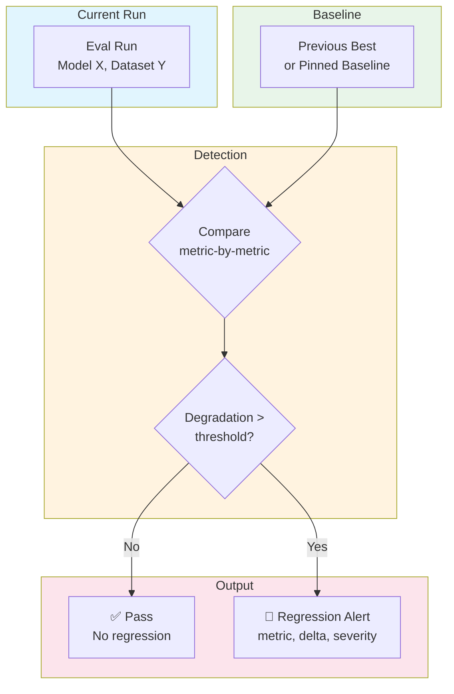

# LLM Evaluation Framework

<div align="center">

```
╔═══════════════════════════════════════════════════════════════════════╗
║                                                                       ║
║     ██╗     ██╗     ███╗   ███╗    ███████╗██╗   ██╗ █████╗ ██╗      ║
║     ██║     ██║     ████╗ ████║    ██╔════╝██║   ██║██╔══██╗██║      ║
║     ██║     ██║     ██╔████╔██║    █████╗  ██║   ██║███████║██║      ║
║     ██║     ██║     ██║╚██╔╝██║    ██╔══╝  ╚██╗ ██╔╝██╔══██║██║      ║
║     ███████╗███████╗██║ ╚═╝ ██║    ███████╗ ╚████╔╝ ██║  ██║███████╗ ║
║     ╚══════╝╚══════╝╚═╝     ╚═╝    ╚══════╝  ╚═══╝  ╚═╝  ╚═╝╚══════╝ ║
║                                                                       ║
║     Multi-model evaluation framework with RAG, voice, tracing,       ║
║     regression detection, and OpenTelemetry observability             ║
║                                                                       ║
╚═══════════════════════════════════════════════════════════════════════╝
```

[](https://python.org)
[](https://fastapi.tiangolo.com)
[](https://ml-explore.github.io/mlx/)
[](https://www.trychroma.com/)
[](https://docker.com)

</div>

---

## 🎯 What is this? (Beginner Friendly)
How do we know if an AI like ChatGPT or Claude is actually giving good answers? This project is an **LLM Evaluation Framework**! It runs automated tests on multiple AI models using RAG (Retrieval-Augmented Generation) and voice inputs, scoring them on faithfulness, relevance, and hallucinations so we always pick the best model for the job.


*Note: The GIF above illustrates how the evaluation engine coordinates RAG pipelines, voice models, and scoring metrics to produce a detailed performance report.*

---

## Architecture



## Evaluation Flow



## Evaluation Modes



## Project Structure

```
llm-eval/
├── eval/
│   ├── runner.py                  # EvalRunner orchestrator
│   ├── comparison.py              # Multi-model comparison engine
│   ├── regression.py              # Regression detection + alerts
│   ├── metrics/
│   │   ├── base.py                # BaseMetric, MetricResult, EvalMode
│   │   ├── faithfulness.py        # F1-based faithfulness scoring
│   │   ├── relevance.py           # Token overlap relevance
│   │   ├── hallucination.py       # Sentence-level NLI detection
│   │   ├── latency.py             # Response latency tracking
│   │   ├── cost.py                # Token cost calculation
│   │   └── voice/
│   │       ├── stt_accuracy.py    # WER, CER metrics
│   │       ├── tts_quality.py     # MOS, naturalness scoring
│   │       └── voice_latency.py   # Voice pipeline latency
│   └── tests/test_metrics.py      # Metric tests
├── models/
│   ├── registry.py                # ModelRegistry + YAML config loader
│   ├── providers/
│   │   ├── base.py                # BaseProvider abstract class
│   │   ├── openai_provider.py     # OpenAI GPT provider
│   │   ├── anthropic_provider.py  # Anthropic Claude provider
│   │   ├── mlx_provider.py        # MLX local inference
│   │   └── custom_provider.py     # OpenAI-compatible endpoints
│   └── tests/test_registry.py     # Registry tests
├── rag/
│   ├── pipeline.py                # RAGPipeline (index → retrieve → generate)
│   ├── retriever.py               # Vector retriever + cosine similarity
│   ├── embeddings.py              # Embedding providers
│   ├── chunker.py                 # Token/separator-based chunking
│   └── tests/test_pipeline.py     # RAG pipeline tests
├── tracing/
│   ├── otel_setup.py              # OTel SDK initialization
│   ├── span_decorators.py         # @trace_eval decorator (sync + async)
│   ├── kafka_exporter.py          # Trace export to Kafka
│   └── tests/test_tracing.py      # Tracing tests
├── voice/
│   ├── stt_runner.py              # Speech-to-text orchestrator
│   ├── tts_runner.py              # Text-to-speech orchestrator
│   ├── audio_utils.py             # Audio loading, resampling, conversion
│   ├── providers/
│   │   ├── mlx_whisper.py         # Local MLX Whisper STT
│   │   ├── openai_whisper.py      # OpenAI Whisper API STT
│   │   ├── openai_tts.py          # OpenAI TTS API
│   │   └── local_tts.py           # Local TTS engine
│   └── tests/test_voice.py        # Voice pipeline tests
├── datasets/
│   ├── loader.py                  # JSON dataset loader
│   ├── voice_loader.py            # Audio dataset loader
│   └── samples/qa_sample.json     # Sample Q&A dataset
├── api/
│   ├── main.py                    # FastAPI application
│   ├── models.py                  # Pydantic request/response models
│   ├── routes/
│   │   ├── evals.py               # POST /api/evals/run, GET /api/evals/{id}
│   │   ├── models.py              # POST /api/models/register, GET /api/models
│   │   ├── compare.py             # GET /api/evals/compare
│   │   ├── regressions.py         # GET /api/regressions
│   │   └── health.py              # GET /health
│   └── tests/test_api.py          # API route tests
├── db/
│   ├── models.py                  # SQLAlchemy ORM models
│   ├── init.sql                   # Database schema
│   └── migrations/                # Alembic versioning
├── tests/
│   ├── test_integration.py        # End-to-end eval pipeline test
│   ├── test_load.py               # Locust: concurrent eval runs
│   └── test_stress.py             # Locust: large-scale eval stress
├── docker-compose.yml             # Eval + ChromaDB + PostgreSQL
├── docker-compose.full.yml        # + Log Pipeline stack
├── docker-compose.monitoring.yml  # + OTel + Prometheus + Grafana
├── Dockerfile
├── Makefile
├── model-registry.yaml            # Model configuration
└── pyproject.toml
```

## Quick Start

```bash
# Start eval stack: service + ChromaDB + PostgreSQL
make up

# Run evaluation
make eval

# Multi-model comparison
make compare

# Start with log-pipeline integration
make up-full

# Full monitoring stack
make up-monitoring
```

## Model Registry

Configure models in `model-registry.yaml`:

```yaml
models:
  gpt-4o:
    provider: openai
    model_id: gpt-4o
    type: [text, vision]
  claude-sonnet:
    provider: anthropic
    model_id: claude-sonnet-4-20250514
    type: [text]
  llama-3.2-1b-local:
    provider: mlx
    model_id: mlx-community/Llama-3.2-1B-Instruct
    type: [text]
  whisper-local:
    provider: mlx
    model_id: mlx-community/whisper-large-v3
    type: [stt]
  custom-endpoint:
    provider: custom
    base_url: http://localhost:11434/v1
    model_id: my-model
    type: [text]
```

## API Endpoints

| Method | Endpoint | Description |
|--------|----------|-------------|
| `POST` | `/api/evals/run` | Trigger eval run `{models, dataset, metrics, mode}` |
| `GET` | `/api/evals/{run_id}` | Get eval run results |
| `GET` | `/api/evals/compare` | Multi-model comparison |
| `GET` | `/api/regressions` | Regression alerts |
| `POST` | `/api/models/register` | Register a new model |
| `GET` | `/api/models` | List registered models |
| `GET` | `/health` | Service health check |
| `GET` | `/metrics` | Prometheus scrape endpoint |

## Tracing Integration with Log Pipeline



Eval functions decorated with `@trace_eval` automatically export spans through the OTel Collector to Kafka, where the Log Pipeline's Faust worker processes and stores them in PostgreSQL. Query traces via: `GET /api/traces?service=llm-eval`

## Regression Detection



## Makefile Targets

```bash
make up               # Eval + ChromaDB + PostgreSQL
make up-full          # + Log Pipeline stack (Kafka, Faust, API)
make up-monitoring    # + OTel Collector + Prometheus + Grafana
make down             # Tear down everything
make eval             # Run evaluation suite
make eval-voice       # Run voice evaluation suite
make compare          # Multi-model comparison
make register-model   # Add model to registry
make test             # Unit tests (pytest)
make test-load        # Locust: concurrent evals
make test-stress      # Locust: large-scale eval
make dev              # API with auto-reload
make seed             # Load sample eval datasets
make migrate          # Alembic migrations
make lint             # ruff + mypy
```

## Configuration

| Variable | Description | Default |
|----------|-------------|---------|
| `DATABASE_URL` | PostgreSQL connection | `postgresql://...` |
| `CHROMA_HOST` | ChromaDB host | `localhost` |
| `CHROMA_PORT` | ChromaDB port | `8000` |
| `OPENAI_API_KEY` | OpenAI API key | — |
| `ANTHROPIC_API_KEY` | Anthropic API key | — |
| `VOICE_PROVIDER` | Voice engine: `local\|api\|auto` | `auto` |
| `OTEL_ENDPOINT` | OTel Collector endpoint | `http://localhost:4317` |
| `KAFKA_BROKER` | Kafka broker (for tracing) | `localhost:9092` |
| `LOG_PIPELINE_API` | Log Pipeline API URL | `http://localhost:8000` |

## License

MIT
